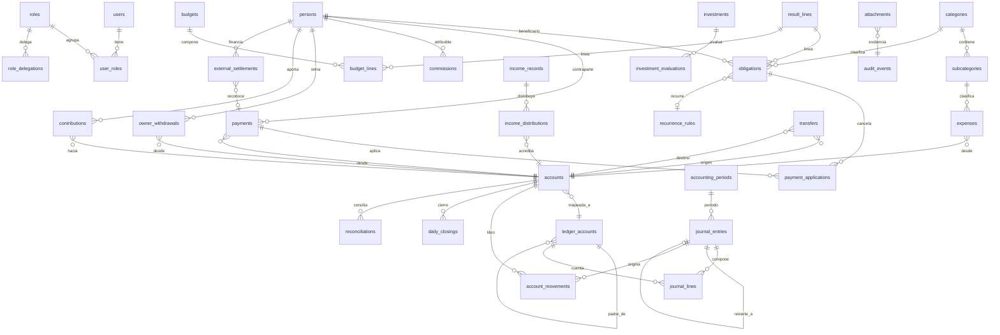

# D1 — Modelo entidad-relación lógico

> Entregable **D1** de la spec `docs/specs/sistema-financiero-diseno.md` (§5).
> Bloque **B1** (D1 + D2). Fase: diseño. **No implementa código ni migraciones SQL ejecutables.**
> Fuentes: `PLANIFICACION_SISTEMA_FINANCIERO_STYLOS.md` (F1, §4.1, §9–§12) y `ANALISIS_FUNCIONAL_SISTEMA_FINANCIERO_STYLOS.md` (F2, §5, §8–§10, §13, §13.1, §18).

## 0. Estado y alcance

- **Estado:** v0 borrador de diseño. No congelado: depende de cierre de P3 (naturaleza de cuentas) y de la revisión conjunta Dirección + Tesorería (F2 §24).
- **Incluye:** diagrama lógico, diccionario de entidades principales, invariantes/constraints sugeridas, estados principales, trazabilidad a RF/CU.
- **Excluye:** DDL ejecutable, policies RLS concretas (van en D6), matriz de contabilización (D3), contratos de servicio (D4), migración (D8).
- **Regla de rechazo §9:** el dominio (saldo, aplicación, asiento, reversión, idempotencia) no vive en componentes visuales; las mutaciones monetarias entran por servicios transaccionales.

### Glosario mínimo (F2 §5, F2 §9)

| Concepto | Definición operativa |
|---|---|
| Documento operativo | Intención o evidencia del usuario (obligación, gasto, pago, transferencia, retiro, aporte, ingreso, cierre, inversión candidata). |
| Movimiento financiero | Efecto sobre **una** cuenta financiera. Un documento puede generar 0, 1 o varios. |
| Asiento | Efecto canónico sobre el libro (débitos = créditos). Solo se genera al **confirmar un hecho real**. |
| Proyección | Efecto futuro posible. Nunca se mezcla con el libro real; conserva `source` + `confidence`. |

## 1. Principio rector: cuatro planos separados

El modelo separa explícitamente cuatro planos relacionados pero **no fusionables** (F1 §11 "decisión estructural clave"; F2 §9). Un error repetido en el sistema actual es confundir cierre con ingreso y obligación con pago; el modelo lo impide por construcción.

```
Documento operativo  ──genera──▶  Movimiento financiero  ──genera──▶  Asiento (journal_entries + journal_lines)
      │                                                                        ▲
      │                                                                        │  (registro canónico, inmutable)
      └──alimenta (nunca escribe)──▶  Proyección (income_forecasts, investment_scenarios)
```

- Un **documento** es la intención/evidencia; no escribe el libro por sí mismo.
- Un **movimiento** representa el efecto sobre una cuenta financiera.
- Un **asiento** es el registro canónico balanceado; se genera al confirmar un hecho real.
- Una **proyección** (estimado o escenario) **no genera asiento** nunca (F2 §9, CU-015).

## 2. Diagrama lógico (ER)



> Convención de notación: `o{` = cero o muchos, `||` = exactamente uno, `}o--||` = muchos a uno. El diagrama es lógico: no fija nombres físicos de tablas ni índices.

## 3. Diccionario de entidades principales

Convenciones de tipos a aplicar a **todas** las entidades (§6): PK `uuid` inmutable; importes `numeric(18,2)`; moneda ISO-4217 explícita; fechas/hora `timestamptz`; zona operativa `America/Buenos_Aires`; `created_at`, `created_by`; `idempotency_key` cuando hay efecto monetario.

### 3.1 Identidad y acceso

| Entidad | Rol | Atributos clave | Notas |
|---|---|---|---|
| `users` | Identidad de acceso | `id` (PK, = identidad auth), `email`, `is_active`, `created_at` | No expone permisos; los permisos viven en roles. |
| `roles` | Agrupación de permisos | `id`, `code` (`DIRECCION`/`TESORERIA`/`CONTADOR`/`ADMIN_TECNICO`), `name` | Códigos, no nombres de personas (F1 §4.11). |
| `user_roles` | Asignación N:M | `user_id` (FK), `role_id` (FK), `granted_at`, `granted_by` | UNIQUE(`user_id`,`role_id`). |
| `role_delegations` | Delegación temporal | `id`, `role_code`, `delegate_user_id`, `starts_at`, `ends_at`, `reason`, `created_by` | Decisión P13. Persistente = asignación normal; temporal = fila con vigencia. |

### 3.2 Maestros (con vigencia)

Todos los maestros usan `valid_from` / `valid_to` (nullable = vigente) para no sobrescribir historia (F1 §4.1 "vigencia de catálogos").

| Entidad | Rol | Atributos clave |
|---|---|---|
| `persons` | Contrapartes: personal, proveedores, socios, MARI | `id`, `display_name`, `kind` (`PERSONA`/`EMPRESA`), `tax_id` (nullable), `valid_from`, `valid_to` |
| `categories` | Clasificación operativa nivel 1 | `id`, `code`, `name`, `nature` (operativa/extraordinaria/financiera), `valid_from`, `valid_to` |
| `subcategories` | Nivel 2, pertenece a categoría | `id`, `category_id` (FK), `code`, `name`, `valid_from`, `valid_to` |
| `result_lines` | Presentación del estado de resultados | `id`, `code`, `name`, `nature` (`INGRESO`/`COSTO`/`GASTO`/`NO_RESULTADO`), `order`, `valid_from`, `valid_to` |
| `ledger_accounts` | Plan de cuentas contable, jerárquico | `id`, `code`, `name`, `nature` (activo/pasivo/patrimonio/ingreso/gasto), `parent_id` (FK self), `is_postable`, `valid_from`, `valid_to` |
| `accounts` | Cuenta **financiera** (efectivo, banco, billetera, transitoria) | `id`, `name`, `kind`, `ownership` (`PROPIA`/`EXTERNA`/`RESTRINGIDA`), `financial_institution`, `currency`, `ledger_account_id` (FK), `is_available`, `is_reconcilable`, `valid_from`, `valid_to` |
| `account_ledger_map` | Mapeo vigente cuenta financiera ↔ cuenta contable | `id`, `account_id` (FK), `ledger_account_id` (FK), `valid_from`, `valid_to` | Tabla sugerida para vigencia histórica del mapeo (ver P3/D2). |

**Distinción obligatoria (F2 §5):** `accounts` = *dónde está el dinero*; `ledger_accounts` = *cómo se clasifica en el libro*. Una cuenta externa (MARI) es `accounts.ownership='EXTERNA'` y **nunca** entra en disponibilidad propia.

### 3.3 Libro (asientos y períodos)

| Entidad | Rol | Atributos clave |
|---|---|---|
| `accounting_periods` | Períodos abiertos/cerrados/reabiertos | `id`, `code` (`2026-10`), `starts_on`, `ends_on`, `status`, `closed_at`, `closed_by`, `reopened_reason` |
| `journal_entries` | Cabecera **inmutable** del asiento | `id`, `entry_no`, `entry_date` (efectiva), `posting_date` (registración), `period_id` (FK), `source_document_type`, `source_document_id`, `description`, `status`, `reverses_entry_id` (FK self, nullable), `idempotency_key`, `created_by`, `created_at` |
| `journal_lines` | Débitos/créditos balanceados | `id`, `entry_id` (FK), `ledger_account_id` (FK), `debit`, `credit`, `currency`, `person_id` (FK, opcional), `category_id` (FK, opcional), `result_line_id` (FK, opcional), `account_id` (FK, opcional) |

- `reverses_entry_id` **UNIQUE** (un asiento original puede tener como máximo una reversión directa).
- `source_document_type` + `source_document_id` identifican el origen; un mismo documento confirmado no puede generar dos asientos canónicos (UNIQUE, ver §4).

### 3.4 Tesorería

| Entidad | Rol | Atributos clave |
|---|---|---|
| `account_movements` | Libro financiero por cuenta | `id`, `account_id` (FK), `effective_date`, `amount` (positivo) + `direction` (`IN`/`OUT`) o `signed_amount`, `currency`, `source_document_type`, `source_document_id`, `journal_entry_id` (FK), `idempotency_key`, `created_at` |
| `daily_closings` | Fotografía conciliatoria de cierre | `id`, `account_id` (FK), `closing_date`, `real_balance`, `currency`, `status`, `created_by` | **No es ingreso** (F1 §4.1, F2 §2). UNIQUE(`account_id`,`closing_date`). |
| `reconciliations` | Comparación teórico vs real | `id`, `account_id` (FK), `period_id` (FK), `as_of`, `theoretical_balance`, `real_balance`, `difference`, `status`, `resolution_note`, `resolved_by` |

### 3.5 Operación (documentos)

| Entidad | Rol | Atributos clave |
|---|---|---|
| `obligations` | Compromiso futuro y saldo pendiente | `id`, `person_id` (FK), `category_id` (FK), `result_line_id` (FK), `planned_account_id` (FK), `estimated_amount`, `estimated_amount_version`, `final_amount` (nullable), `currency`, `due_date`, `expected_payment_date`, `is_estimated`, `priority` (`P1`–`P4`), `status`, `recurrence_rule_id` (FK), `period_id` (FK), `source`, `created_by` |
| `recurrence_rules` | Generación automática de obligaciones | `id`, `template_type`, `frequency`, `interval`, `next_run_on`, `ends_on`, `payload`, `is_active`, `valid_from`, `valid_to` |
| `expenses` | Hecho económico y clasificación del gasto | `id`, `effective_date`, `person_id` (FK), `category_id` (FK), `subcategory_id` (FK), `result_line_id` (FK), `account_id` (FK), `amount`, `currency`, `detail`, `period_id` (FK), `origin` (`REAL`/`LEGACY`), `created_by` |
| `payments` | Cancelación financiera total/parcial | `id`, `effective_date`, `account_id` (FK), `amount`, `currency`, `status`, `attachment_required`, `idempotency_key`, `origin`, `created_by` |
| `payment_applications` | Aplicación de un pago a una obligación | `id`, `payment_id` (FK), `obligation_id` (FK), `applied_amount`, `currency` |
| `transfers` | Movimiento entre cuentas propias | `id`, `effective_date`, `from_account_id` (FK), `to_account_id` (FK), `amount`, `currency`, `idempotency_key`, `status`, `created_by` | Origen ≠ destino (§4). Sin efecto en resultado. |
| `commissions` | Comisión por persona/período | `id`, `person_id` (FK), `period_id` (FK), `amount`, `currency`, `rule_ref`, `origin` (`REAL`/`LEGACY`), `legacy_evidence_level`, `created_by` | Las comisiones históricas pueden no tener ID (F2 §18). |
| `owner_withdrawals` | Retiros ajenos al resultado operativo | `id`, `person_id` (FK), `effective_date`, `account_id` (FK), `amount`, `currency`, `status`, `idempotency_key` |
| `contributions` | Aportes (propietario o tercero) | `id`, `person_id` (FK), `effective_date`, `account_id` (FK), `amount`, `currency`, `nature` (`APORTE`), `status` |
| `income_records` | Ingreso/cobranza diaria agregada (CU-012) | `id`, `effective_date`, `service_amount`, `product_amount`, `currency`, `period_id` (FK), `adjustment_note`, `status`, `created_by` | **Nombre PENDIENTE**: F1 §11 no enumera esta entidad explícita; se propone para RF-005 / CU-012. |
| `income_distributions` | Distribución de la cobranza entre cuentas | `id`, `income_record_id` (FK), `account_id` (FK), `amount`, `currency` |
| `external_settlements` | Pago/fondos por cuenta externa (MARI) y su reconocimiento | `id`, `source_person_id` (FK), `target_ref_type`, `target_ref_id`, `amount`, `currency`, `nature` (`PRESTAMO`/`APORTE`/`CUENTA_CORRIENTE`), `status`, `note` | Naturaleza PENDIENTE (P7). Nunca computa como caja propia. |

### 3.6 Planificación y proyección

| Entidad | Rol | Atributos clave |
|---|---|---|
| `budgets` | Presupuesto mensual | `id`, `period_id` (FK), `status`, `approved_by`, `created_by` |
| `budget_lines` | Plan por línea de resultado | `id`, `budget_id` (FK), `result_line_id` (FK), `amount`, `currency` |
| `income_forecasts` | Ingresos esperados **proyectados** | `id`, `scenario` (`CONSERVADOR`/`BASE`/`OPTIMISTA`), `forecast_date`/`week`, `amount`, `currency`, `source` (`CONFIRMADO`/`RECURRENTE`/`MANUAL`/`PROMEDIO`/`ESCENARIO`), `confidence` (`ALTA`/`MEDIA`/`BAJA`), `account_id` (FK, opcional) |
| `investments` | Inversión candidata/aprobada | `id`, `concept`, `amount`, `currency`, `tentative_date`, `status`, `created_by` |
| `investment_evaluations` | Evaluación de escenario de inversión | `id`, `investment_id` (FK), `scenario`, `min_projected_balance`, `capacity_amount`, `earliest_date`, `assumptions`, `confidence`, `evaluated_at` |

- `income_forecasts` y `investment_evaluations` **nunca** generan `account_movements` ni `journal_entries` (F2 §9).
- `source` + `confidence` son obligatorios en toda proyección (RF-017, RNF-011, F2 §14).

### 3.7 Soporte transversal

| Entidad | Rol | Atributos clave |
|---|---|---|
| `attachments` | Comprobantes/documentos privados | `id`, `entity_type`, `entity_id`, `storage_key`, `checksum`, `mime`, `is_private`, `uploaded_by`, `created_at` | Storage privado (D6). |
| `audit_events` | Historial **inmutable** de cambios relevantes | `id`, `entity_type`, `entity_id`, `action`, `actor_user_id`, `occurred_at`, `before` (jsonb), `after` (jsonb), `reason` | F2 §19. |
| `settings_parameters` | Parámetros versionados (sueldo, reserva, umbrales) | `id`, `key`, `value`, `valid_from`, `valid_to`, `approved_by` | Parametriza P1/P2/P14; no fija valores. |

## 4. Invariantes y constraints sugeridas

Las invariantes críticas se protegen **en dominio y en base de datos** (§9). No basta con validación de UI.

### 4.1 Balance y libro

| # | Invariante | Enforcement sugerido |
|---|---|---|
| I-01 | Toda entrada de `journal_entries` confirmada está balanceada: `Σ debit = Σ credit` | Constraint trigger diferido sobre `journal_lines` (no es un `CHECK` de fila). |
| I-02 | Un asiento confirmado es inmutable | Trigger que bloquea `UPDATE`/`DELETE` cuando `status='CONFIRMADO'`. |
| I-03 | Corrección = reversión + reemplazo, nunca update silencioso | `journal_entries.reverses_entry_id` UNIQUE + FK. Asiento inverso (D3). |
| I-04 | Un documento confirmado real genera a lo sumo un asiento canónico | UNIQUE(`source_document_type`, `source_document_id`) para asientos no-reversión. |
| I-05 | Solo hechos reales confirmados generan asiento | `journal_entries` referencia únicamente documentos operativos confirmados; proyecciones no tienen FK a libro. |
| I-06 | Importes `numeric(18,2)`, nunca punto flotante | Tipo de columna (RNF-004). |

### 4.2 Tesorería y operación

| # | Invariante | Enforcement sugerido |
|---|---|---|
| I-07 | Transferencia: `from_account_id <> to_account_id` | CHECK a nivel fila. |
| I-08 | Transferencia no afecta resultado | Sus `journal_lines` solo tocan cuentas de disponibilidad (no `result_lines`). Ver D3. |
| I-09 | `Σ applied_amount` de un pago **no supera** `payments.amount` | Trigger/constraint sobre `payment_applications` (aplicado ≤ pago). |
| I-10 | `Σ applied_amount` por obligación no supera el importe exigible | Trigger; excedente solo como anticipo explícito (F2 §12 CU-006). |
| I-11 | Todo importe positivo | CHECK `amount > 0`. |
| I-12 | Moneda explícita y consistente | `currency` NOT NULL; CHECK de consistencia cuando aplica. |
| I-13 | `account_movements` no duplica por reintento | UNIQUE(`idempotency_key`) por tipo de operación (RNF-014). |
| I-14 | Pago desde cuenta inactiva prohibido (salvo histórica/legado) | Validación de vigencia; excepción `origin='LEGACY'`. |
| I-15 | `subcategories.category_id` coincide con la categoría del documento | FK compuesta o validación de dominio. |
| I-16 | `ledger_accounts` / `result_lines` / `categories` deben estar vigentes a la fecha del hecho | Validación de vigencia (`valid_from`/`valid_to`) al confirmar. |
| I-17 | Cuenta externa (MARI) nunca computa disponibilidad propia | `accounts.ownership='EXTERNA'` excluida de disponibilidad (D2, §8 F2). |

### 4.3 Períodos, concurrencia e idempotencia

| # | Invariante | Enforcement sugerido |
|---|---|---|
| I-18 | No se postea en período `CERRADO` | Validación transaccional; reapertura solo con motivo y auditoría (RF-029). |
| I-19 | Toda operación monetaria es transaccional (pago + aplicación + movimiento + asiento) | Servicio de aplicación con transacción única (D4). |
| I-20 | Reintento con misma `idempotency_key` devuelve el resultado previo, sin duplicar | `idempotency_key` UNIQUE + patrón de servicio (D4). |
| I-21 | Sin escrituras dispersas desde UI/repositorios sueltos | Mutaciones solo vía servicios transaccionales (§9). |

## 5. Estados principales

### 5.1 Obligación (F2 §10.1, F1 §9)

`BORRADOR → PENDIENTE → PROGRAMADA → PARCIAL → PAGADA`
- `PENDIENTE / PROGRAMADA / PARCIAL → VENCIDA` (por fecha).
- `BORRADOR / PENDIENTE / PROGRAMADA → ANULADA` (con motivo).
- Una obligación `PARCIAL` **no** se anula sin resolver antes el pago aplicado.

### 5.2 Pago (F2 §10.2)

`BORRADOR → CONFIRMADO → CONCILIADO`
- `BORRADOR → ANULADO`.
- `CONFIRMADO / CONCILIADO → REVERTIDO` (mediante asiento inverso).
- Un pago confirmado **no se edita** en importe, cuenta o fecha efectiva: se revierte y reemplaza.

### 5.3 Inversión candidata (F2 §10.3)

`BORRADOR → EVALUADA → APROBADA → COMPROMETIDA → PAGADA`
- `EVALUADA → POSTERGADA`; `EVALUADA / APROBADA → RECHAZADA`.
- Cambiar importe o fecha tras aprobar **exige nueva evaluación**.

### 5.4 Período (F2 §10.4)

`ABIERTO → EN_REVISION → CERRADO`
- Reapertura solo con permiso de Dirección, motivo y auditoría.

### 5.5 Otros estados

| Entidad | Estados |
|---|---|
| `journal_entries` | `BORRADOR → CONFIRMADO → REVERTIDO` |
| `daily_closings` | `BORRADOR → CONFIRMADO` |
| `reconciliations` | `PENDIENTE → RESUELTA` (`AJUSTE` / `EXPLICADA`) |
| `expenses` / `income_records` | `BORRADOR → CONFIRMADO → ANULADO` (anulación no borra historia) |
| Evidence de legado | `origin='LEGACY'` + `legacy_evidence_level` (`COMPLETO`/`PARCIAL`/`SOLO_SALDO`) |

## 6. Convenciones de tipos y metadata

| Aspecto | Regla |
|---|---|
| PK | `uuid` inmutable, generada por la aplicación. |
| Importes | `numeric(18,2)`. Prohibido punto flotante (RNF-004). |
| Moneda | ISO-4217 explícita en toda fila monetaria (default conceptual `ARS`, pero **explícita**). |
| Fechas/hora | `timestamptz`; zona operativa `America/Buenos_Aires`. |
| Fecha efectiva vs registración | `effective_date` (hecho) y `created_at`/`posting_date` (registro) son columnas separadas. |
| Vigencia | `valid_from` / `valid_to` (null = vigente) en maestros; no se borra historia. |
| Periodo | FK `period_id` obligatoria en hechos reales; controla cierre/reversión. |
| Idempotencia | `idempotency_key` en operaciones monetarias (pago, transferencia, movimiento, aporte/retiro). |
| Auditoría | `created_by`, `created_at` en todas; cambios relevantes → `audit_events`. |
| Origen | `source` / `origin` (`REAL`/`LEGACY`) en documentos migrados. |
| Proyección | `scenario` + `source` + `confidence` obligatorios (RNF-011). |
| Portabilidad | Sin tipos/extensiones específicas de Supabase en el dominio (F1 §12). |

## 7. Trazabilidad a RF / CU

| Entidad / invariante | RF | CU |
|---|---|---|
| `accounts`, `account_movements`, `daily_closings`, `reconciliations` | RF-004, RF-005, RF-014 | CU-010, CU-011 |
| `obligations`, `recurrence_rules` | RF-010, RF-013 | CU-003, CU-004, CU-005 |
| `payments`, `payment_applications` | RF-011, RF-012 | CU-006 |
| `transfers` | RF-009 | CU-008 |
| `expenses`, `commissions` | RF-006, RF-007 | — |
| `owner_withdrawals`, `contributions` | RF-008 | — |
| `income_records`, `income_distributions` | RF-005 | CU-012 |
| `external_settlements` | RF-021 | CU-009 |
| `journal_entries`, `journal_lines` | RF-027, RF-028 | CU-021 |
| `accounting_periods` | RF-029 | CU-020 |
| `idempotency_key` (I-13, I-20) | RF-030 | CU-006 |
| `income_forecasts`, `investments`, `investment_evaluations` | RF-015, RF-017 | CU-013, CU-015, CU-016 |
| `ledger_accounts`, plan de cuentas | RF-003, RF-004 | CU-025 |
| `audit_events` | RF-023 | CU-022 |
| Vigencia de maestros | RF-003, RF-034 | CU-025, CU-027 |

## 8. Decisiones pendientes relacionadas

Ninguna decisión de negocio se cierra en este diseño; se parametriza (spec §10).

| # (P) | Impacto en D1 | Cómo lo soporta el modelo |
|---|---|---|
| P3 | Naturaleza/titularidad de Santander WASHINGTON y BaPro MILTON; rol de MARI | `accounts.ownership`, `account_ledger_map`; MARI = `EXTERNA`. |
| P7 | Tratamiento de pagos por terceros (MARI): préstamo/aporte/cuenta corriente | `external_settlements.nature` admite las tres; se define al confirmar. |
| P11 | Sueldo: pago vs devengamiento | `obligations` + `result_lines`; el reconocimiento se resuelve en D3/contratos. |
| P13 | Suplente Tesorería y delegación temporal | `role_delegations` (inicio/fin/motivo). |
| P8 | Fecha de corte y alcance de migración | `origin='LEGACY'` + `legacy_evidence_level`. |
| P9 | Plazo de conservación de comprobantes | `attachments` (política de retención en D6). |
| P15 | Hora de corte operativo diario / cierre mensual | `daily_closings` + `accounting_periods`. |
| Nombre de la entidad de ingreso diario | **PENDIENTE** — `income_records` es nombre propuesto (F1 §11 no lo enumera). | |

> **Nota de no-asunción:** este documento no copia literalmente las tablas actuales de AppSheet/Sheets (F2 §7 "riesgo de replicación"); propone un modelo transformado. Toda decisión de negocio permanece **PENDIENTE** hasta cierre formal.

## 9. Próximo paso

- Validar el diccionario y las invariantes con Dirección + Tesorería (F2 §24).
- Derivar **D2 (plan de cuentas)** — ver `plan-cuentas.md`.
- Alimentar **D3 (matriz de contabilización)** con las entidades de §3.3–§3.5.
