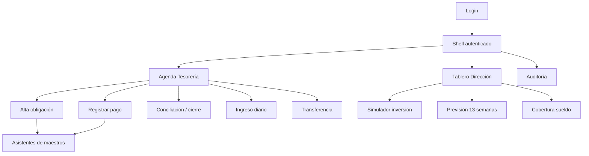

# D5 — Prototipos navegables (diseño funcional)

> Entregable **D5** de la spec `docs/specs/sistema-financiero-diseno.md` (§5).
> Bloque **B4** (Hito A). Fase: **diseño**. **No es UI final; no implementa componentes.**
> Depende de `ER.md` (**D1**), `plan-cuentas.md` (**D2**), `matriz-contabilizacion.md` (**D3**) y `contratos-dominio.md` (**D4**).
> Fuentes: F1 §7, §10, §16 (Hito A); F2 §9, §12, §13.1, §24.10; RNF-011, RNF-012. Decisiones **P1–P4**, **P6**, **P7**, **P13** (spec §10).

## 0. Estado y alcance

- **Estado:** **v0 borrador**. No congelado. Depende de cierre de P1–P4 y de la validación conjunta Dirección + Tesorería.
- **Incluye:** mapa de navegación, shell, diseño funcional de 7 pantallas/flujos (tablero Dirección, agenda Tesorería, alta obligación, pago + conciliación, ingreso diario, simulador de inversión, asistentes de maestros), campos, validaciones, estados, mensajes de error, comportamiento mobile/desktop y criterios de aceptación del **Hito A**.
- **Excluye:** diseño visual final, tipografías/color, librería de componentes, código, DDL.
- **Regla RNF-012:** la interfaz usa **lenguaje de negocio**; no expone débitos/créditos ni el plan contable. Distingue siempre **real / estimado / proyectado** (RNF-011).
- **Regla §9:** los componentes visuales **no** calculan saldos, previsión, asientos ni aplicaciones; consumen servicios (D4).

## 1. Principios de prototipado

| # | Principio | Implicación |
|---|---|---|
| P-1 | **Mobile-first para operación; desktop para análisis** (F1 §12) | Tesorería opera desde el celular; Dirección analiza en escritorio. |
| P-2 | **Lenguaje de negocio** (RNF-012) | "Pagar", "Transferir", "Cobranza del día", no "haber/debe". |
| P-3 | **Real / estimado / proyectado visible** (RNF-011) | Chip de estado en cada importe y fila de previsión. |
| P-4 | **Nada se crea como texto libre** (F1 §12) | Si falta un maestro, se abre un asistente; el documento queda en borrador (F2 §12, §13.1). |
| P-5 | **Impacto visible antes de confirmar** | Alta de obligación y pago muestran su efecto en la previsión (CU-003, CU-006). |
| P-6 | **Instrucciones en contexto** (RF-035, RNF-018) | Cada flujo muestra ayuda y criterio versionados. |
| P-7 | **Continuidad del rol** (F2 §11.1) | Bandeja compartida, pendientes, suplente, historial de quién ejecutó. |

## 2. Mapa de navegación

**Shell:** encabezado con rol activo, cuenta/bandeja de Tesorería, indicador de sincronización y fuera-de-borrador. En mobile, navegación inferior con 4 destinos: *Agenda*, *Cobranza*, *Previsión*, *Más*. En desktop, barra lateral con todos los destinos.

### Flujos clicables del Hito A (F1 §16)

| # | Flujo | CU | Actor |
|---|---|---|---|
| 1 | Tablero Dirección → previsión / cobertura sueldo | CU-013, CU-014 | Dirección |
| 2 | Agenda Tesorería → alta obligación (13 preguntas) | CU-003 | Tesorería |
| 3 | Agenda → registrar pago (parcial/total) | CU-006 | Tesorería |
| 4 | Conciliación / cierre de cuenta | CU-010, CU-011 | Tesorería |
| 5 | Simulador de inversión | CU-015 | Dirección |

> Además se prototipan **ingreso diario** (CU-012) y los **asistentes de maestros** (CU-025/F2 §13.1) por ser prerrequisito de los anteriores (P-4).

## 3. Pantalla — Tablero Dirección (CU-013, CU-014)

**Objetivo:** responder las 3 decisiones del producto (F1 §1): sueldo, dinero realmente disponible, cuánto y cuándo invertir.

| Zona | Contenido | Estado | Nota |
|---|---|---|---|
| Cabecera de salud | Reserva vigente, saldo conciliado total, **menor saldo proyectado 13 sem.** | Real + proyectado | Chip de escenario activo. |
| Cobertura obligaciones 30 días | Fondos proyectados / obligaciones próximas | Proyectado | Indicador F1 §10. |
| Cobertura sueldo | `reservado+pagado` sobre `planificado`; estados `planificado/reservado/pagado/pendiente/vencido` | Mixto | F2 §15. |
| Capacidad de inversión | Importe máximo hoy, fecha más temprana, saldo mínimo antes/después | Proyectado | F2 §16. |
| Obligaciones por prioridad | P1–P4 con vencidas resaltadas | Real | F1 §9. |
| Previsión 13 semanas | Minigráfico semanal + acceso a detalle diario | Proyectado | CU-013. |
| Alertas | F2 §21 | Mixto | Ver D7 §9. |

- **Estados:** por defecto **escenario conservador** (guarda F2 §23). Selector conservador/base/optimista visible.
- **Validaciones:** no muestra capacidad de inversión si no hay saldos conciliados recientes o reserva vigente ⇒ mensaje `STALE_RECONCILIATION` / `RESERVE_UNDEFINED` (D4 §5).
- **Mensajes:** "La previsión parte del último cierre conciliado del {fecha}." · "Aún sin reserva definida: contactá a Dirección ({P2})."
- **Desktop:** grid de 2 columnas. **Mobile:** tarjetas apiladas; previsión en carrusel semanal.

## 4. Pantalla — Agenda Tesorería (CU-002, CU-003, CU-006, CU-010)

**Objetivo:** bandeja única del rol con pendientes, vencimientos, recurrencias por generar y conciliaciones abiertas (F2 §11.1, §20).

| Zona | Contenido |
|---|---|
| Bandeja del rol | Tareas asignadas, con **quién ejecutó** vs **a quién pertenece** la tarea. |
| Vencimientos | Próximos / vencidos, por prioridad (P1–P4). |
| Por generar | `recurrence_rules` vencidas (CU-004). |
| Conciliaciones | Cierres con diferencia pendiente (CU-011). |
| Pagos sin comprobante | Cuando es obligatorio (F2 §20). |
| Acciones | Alta obligación · Registrar pago · Transferir · Cobranza · Cerrar/conciliar. |

- **Suplente (P13):** indicador de suplente activo; reasignación sin transferir credenciales (F2 §17).
- **Estados vacíos:** "Sin pendientes para hoy." · "No hay recurrencias por generar."
- **Mobile:** lista filtrable por "Hoy / Vencidas / Semana". **Desktop:** grilla con filtros y orden por prioridad.

## 5. Pantalla — Alta de obligación (CU-003)

Flujo guiado de **13 preguntas** (F2 §12). En pasos, con validaciones por paso, búsqueda de duplicados y vista de impacto.

| Paso | Pregunta (CU-003) | Campo (D1 `obligations`) | Validación |
|---|---|---|---|
| 1 | ¿Qué debe pagarse? | `concept` | Requerido. |
| 2 | ¿A quién se debe? | `personId` | Requerido; si no existe → asistente persona (borrador). |
| 3 | ¿Existe factura/contrato/mensaje u otro respaldo? | `evidenceRef`/`attachmentId` | Requerido según tipo (F2 §13). |
| 4 | ¿El importe es exacto o estimado? | `isEstimated` | Requerido. |
| 5 | ¿Cuál es el importe y la moneda? | `estimatedAmount`+`currency` | `> 0`; moneda explícita (ARS default). |
| 6 | ¿Cuándo vence y cuál es la fecha probable de pago? | `dueDate`/`expectedPaymentDate` | `dueDate` requerida. |
| 7 | ¿Es única o recurrente? | `isRecurring`/`recurrenceRuleId` | Requerido; recurrente → asistente recurrencia. |
| 8 | ¿A qué período económico corresponde? | `periodId` | Requerido; no `CERRADO`. |
| 9 | ¿Qué categoría y línea de resultado describe el concepto? | `categoryId`+`resultLineId` | Vigentes (D1 I-16). |
| 10 | ¿Involucra una persona identificable? | `personId` | Según caso. |
| 11 | ¿Desde qué cuenta se prevé pagar? | `plannedAccountId` | Propia y vigente. |
| 12 | ¿Qué ocurre si se posterga? | `postponeImpact` | Opcional. |
| 13 | ¿Requiere aprobación de Dirección? | `requiresApproval` | Requerido. |

**Controles automáticos (CU-003):** buscar similares (contraparte+comprobante+importe+fecha) ⇒ `POSSIBLE_DUPLICATE_OBLIGATION`; impedir número de comprobante repetido para la misma contraparte; validar categoría/subcategoría/persona; sugerir clasificación por historial **sin** confirmarla en silencio (P-4); advertir si la cuenta prevista no tendrá saldo suficiente; **mostrar impacto en previsión antes de confirmar**.

**Resultado:** obligación en bandeja del rol; alertas por vencimiento; inclusión inmediata en previsión; **sin movimiento ni asiento** (D3 EV-04, CU-003).

**Mensajes de error (D4 §5):** `MISSING_DUE_DATE`, `MISSING_CATEGORY`, `MASTER_NOT_CURRENT`, `POSSIBLE_DUPLICATE_OBLIGATION`, `PERIOD_CLOSED`.

- **Mobile:** 1 pregunta por pantalla, barra de progreso. **Desktop:** formulario en 2 columnas con panel de impacto lateral.

## 6. Pantalla — Registrar pago y conciliación (CU-006, CU-010, CU-011)

### 6.a Registrar pago (CU-006)

| Zona | Contenido | Validación |
|---|---|---|
| Selección de obligación | Importe original, **pagos previos**, **saldo pendiente** | Requerida o causa informada. |
| Datos del pago | Fecha, cuenta, importe, moneda | Importe `> 0`; moneda consistente. |
| Aplicación | `appliedAmount` por obligación | `Σ applied ≤ payment.amount` (D1 I-09). |
| Comprobante | Adjunto | Obligatorio según tipo. |
| Impacto | Saldo antes/después, previsión | Visible antes de confirmar. |

**Precondiciones (F2 §12 CU-006):** usuario con permiso; cuenta activa; obligación/causa; período abierto.
**Excepciones y mensajes:** pago > saldo ⇒ `PAYMENT_EXCEEDS_PENDIENTE` (ofrecer anticipo explícito o impedir); cuenta sin saldo ⇒ **advertencia**, no bloqueo (según política); comprobante faltante ⇒ `MISSING_ATTACHMENT`; solicitud repetida ⇒ devuelve el pago previo (`DUPLICATE_IDEMPOTENCY`).
**Resultado:** obligación `PARCIAL`/`PAGADA`; asiento EV-05 balanceado; saldo y previsión recalculados (D3, D4 §4.2).

### 6.b Cierre y conciliación (CU-010, CU-011)

| Paso | Acción | Resultado |
|---|---|---|
| 1 | Tesorería informa saldo real por cuenta (fecha de cierre) | `daily_closings` `CONFIRMADO`. |
| 2 | Sistema calcula saldo teórico desde movimientos | Muestra **diferencia**. |
| 3 | Si hay diferencia | `reconciliation` `PENDIENTE`. |
| 4 | Resolver: **explicar** o **ajustar** (con motivo) | `RESUELTA`; ajuste ⇒ asiento EV-12/12b trazable. |

- **Mensajes:** `ACCOUNT_NOT_RECONCILABLE`, `DUPLICATE_CLOSING` (ya existe cierre de ese día), `MISSING_REASON`.
- **Regla visible:** "El cierre es una fotografía de saldo; **no** es un ingreso." (F1 §4.1).
- **Mobile:** captura de saldo real por cuenta en una lista. **Desktop:** tabla con teórico/real/diferencia y cola de conciliaciones.

## 7. Pantalla — Ingreso diario (CU-012)

**Objetivo:** capturar la cobranza agregada del día (F2 §12 CU-012), separando servicios y productos.

| Campo | Tipo | Validación |
|---|---|---|
| Fecha | fecha | Requerida; no futura. |
| Servicios | Money | `≥ 0`. |
| Productos | Money | `≥ 0`. |
| Distribución por cuenta/medio | filas `{cuenta, importe}` | `Σ distribución = servicios+productos` **o** justificar diferencia. |
| Ajuste/devuelción | texto+importe | Opcional; genera asiento trazable. |
| Comprobante | adjunto | Opcional. |

- **Resultado:** `income_record` `CONFIRMADO` + asiento EV-02 (`Db 1.1.x / Hr 4.1 + 4.2`); el cierre posterior compara teórico vs real (D4 §4.5).
- **Mensajes:** `INCOME_DISTRIBUTION_MISMATCH` (suma ≠ ingreso neto sin nota), `ACCOUNT_NOT_AVAILABLE`, `PERIOD_CLOSED`.
- **Nota de evolución:** el diseño admite sustituir el resumen por ventas/ítems sin cambiar reportes ni libro (F2 §12 CU-012).
- **Mobile-first:** teclado numérico, filas de distribución de un toque.

## 8. Pantalla — Simulador de inversión (CU-015, CU-016)

**Objetivo:** evaluar una inversión candidata **sin alterar datos reales** (F2 §12 CU-015).

**Precondiciones visibles:** saldos conciliados recientes; obligaciones futuras actualizadas; reserva vigente; escenario de ingresos seleccionado.

| Paso | Acción | Salida |
|---|---|---|
| 1 | Dirección informa concepto, importe, fecha tentativa | Candidato en `BORRADOR`. |
| 2 | Sistema recalcula escenario incluyendo el egreso | Saldo antes/después. |
| 3 | Muestra punto mínimo y obligaciones afectadas | Riesgo de cobertura. |
| 4 | Informa capacidad actual, fecha alternativa, confianza | `capacity = max(0, min_proyectado − reserva − protegidos)` (F1 §9). |
| 5 | Dirección **guarda / aprueba / posterga / rechaza** | Estado; **P6**. |

- **Regla visible:** "Una simulación **nunca** modifica saldos ni genera asiento." (F2 §12 CU-015, D3 EV-14).
- **No autorizar solo por optimista** (F2 §16). Guarda: "Ninguna inversión puede presentarse como disponible si deja el saldo proyectado por debajo de la reserva." (F1 §10).
- **Mensajes:** `INVESTMENT_EXCEEDS_CAPACITY`, `REAPPROVAL_REQUIRED` (cambió importe/fecha tras aprobar, F2 §10.3), `STALE_RECONCILIATION`, `RESERVE_UNDEFINED`.
- **Desktop-first:** gráfico de previsión con/sin inversión. **Mobile:** resumen numérico.

## 9. Asistentes de maestros (CU-025–027, F2 §13.1)

### 9.a Alta guiada de cuenta (asistente de 13 preguntas, F2 §13.1)

| # | Pregunta |
|---|---|
| 1 | Nombre visible y entidad financiera |
| 2 | Tipo: efectivo, banco, billetera, tarjeta a acreditar, transitoria u otra |
| 3 | Titular real |
| 4 | Relación del titular con Stylo's |
| 5 | Propiedad: propia, externa, restringida o de tercero |
| 6 | Moneda |
| 7 | Fecha desde la que se utilizará |
| 8 | Posibilidad y frecuencia de conciliación |
| 9 | Si recibe ingresos, realiza pagos o ambas |
| 10 | Saldo inicial y evidencia de la fecha de corte |
| 11 | Si reemplaza o continúa otra cuenta |
| 12 | Responsable operativo |
| 13 | Observaciones y documentación |

Con las respuestas el sistema **propone** (P-4, sin confirmar en silencio): tratamiento en tesorería, cuenta contable asociada (D2), participación/exclusión de disponibilidad, reglas de conciliación, permisos, vigencia y tratamiento de transferencias/fondos externos.
**Guarda dura:** una cuenta externa (MARI) **no** puede quedar clasificada como dinero propio disponible (F2 §13.1, D2 R-D8).

> **Nota:** la spec (§5 D5) menciona "12 preguntas"; F2 §13.1 enumera **13**. Se toma F2 como fuente y la diferencia queda como **PENDIENTE** de confirmación.

### 9.b Otros asistentes (F2 §13.1)

Persona/contraparte · categoría/subcategoría/línea de resultado · obligación recurrente · regla de comisión · sueldo/remuneración · reserva financiera · tipo de inversión · motivo de ajuste/reversión.

| Elemento común | Regla |
|---|---|
| Buscar antes de crear | RF-033; muestra coincidencias y posibles duplicados. |
| Preguntas específicas | Validaciones propias por entidad. |
| Aprobación proporcional al riesgo | Cambio sensible → Dirección aprueba (CU-027, **P13**). |
| Vigencia y versión | `valid_from`/`valid_to`; reglas versionadas (RNF-018). |
| Mensajes | `POSSIBLE_DUPLICATE_MASTER`, `MISSING_REQUIRED_ANSWER`, `APPROVAL_REQUIRED`. |

## 10. Validaciones transversales y mensajes

| # | Validación | Momento | Mensaje (lenguaje de negocio) |
|---|---|---|---|
| V-1 | Importes positivos, `numeric(18,2)`, moneda explícita | Todos | "El importe debe ser mayor a cero." |
| V-2 | No postear en período cerrado | Confirmaciones | "El período está cerrado. Pedí a Dirección una reapertura autorizada." |
| V-3 | Cuenta externa/inactiva ≠ caja propia | Pago/transferencia/ingreso | "Esa cuenta no es dinero disponible propio." |
| V-4 | Origen ≠ destino (transferencia) | Transferencia | "La cuenta de origen y destino deben ser distintas." |
| V-5 | Aplicado ≤ pago; por obligación ≤ exigible | Pago | "El pago supera el saldo pendiente; podés registrarlo como anticipo." |
| V-6 | Comprobante obligatorio | Pago/gasto extraordinario | "Este pago requiere comprobante." |
| V-7 | Motivo en anulación/reversión/reapertura/ajuste | Acciones sensibles | "Indicá el motivo; queda registrado en auditoría." |
| V-8 | Comentario obligatorio en operaciones marcadas | Según operación | "Este movimiento requiere un comentario." |
| V-9 | Real/estimado/proyectado etiquetado | Reportes/previsión | Chip de estado. |

## 11. Comportamiento mobile / desktop

| Aspecto | Mobile (operación) | Desktop (análisis) |
|---|---|---|
| Navegación | Barra inferior (Agenda, Cobranza, Previsión, Más) | Barra lateral completa |
| Alta obligación | Un paso por pantalla | Formulario 2 columnas + impacto lateral |
| Pago | Selección + teclado numérico | Tabla con saldos y aplicaciones |
| Previsión | Carrusel semanal; detalle diario en drill-down | Grilla 13 semanas + gráfico |
| Conciliación | Lista por cuenta | Tabla teórico/real/diferencia |
| Simulador | Resumen numérico | Gráfico con/sin inversión |
| Umbral de rendimiento | < 2 s pantallas operativas (RNF-002) | igual |

## 12. Test Hito A — "otra persona ejecuta el caso solo con app + docs" (F2 §24.10)

| # | Criterio | Verificación |
|---|---|---|
| A-1 | Una persona distinta de quien diseñó completa **CU-003** y **CU-006** sin asistencia técnica | Sesión observada. |
| A-2 | Los 5 flujos del Hito A son clicables con datos de prueba | Recorrido end-to-end. |
| A-3 | Las 13 preguntas de CU-003 y las 13 del alta de cuenta están presentes y validan | Checklist. |
| A-4 | Nunca se escribe un maestro como texto libre: abre asistente o deja borrador | Prueba de flujo faltante. |
| A-5 | Real/estimado/proyectado siempre distinguible (RNF-011) | Inspección de pantallas. |
| A-6 | Sin débitos/créditos expuestos (RNF-012) | Inspección de copy. |
| A-7 | La simulación de inversión no altera datos reales | Comparar antes/después. |
| A-8 | Mobile usable en los flujos operativos; desktop en los analíticos | Prueba en ambos. |
| A-9 | Cada flujo muestra instrucciones/criterio (RF-035, RNF-018) | Inspección. |
| A-10 | Definiciones de obligación/pago/gasto/sueldo/retiro/inversión aceptadas por D+T | Acta (Hito A, F1 §16). |

## 13. Decisiones pendientes

| # | Decisión | Impacto en D5 |
|---|---|---|
| P1 | Importe/calendario del sueldo | Tarjeta de cobertura del sueldo. |
| P2 | Política de reserva (fijo/semanas/combinación) | Capacidad de inversión y guardas del simulador. |
| P3 | Titularidad/naturaleza de cuentas | Asistente de alta de cuenta; disponibilidad. |
| P4 | Criterio de proyección de ingresos inicial | Panel de previsión del tablero. |
| P6 | Reglas de aprobación de inversión (umbrales) | Paso 5 del simulador (bloqueo vs advertencia). |
| P7 | Naturaleza de fondos externos (MARI) | Alta de cuenta externa; pago desde cuenta externa. |
| P13 | Suplente y aprobación de maestros | Bandeja del rol y aprobación de asistentes. |
| P15 | Hora de corte operativo diario | Pantalla de ingreso diario/cierre. |
| 12 vs 13 preguntas | Spec §5 dice 12; F2 §13.1 enumera 13 | Asistente de alta de cuenta (`PENDIENTE`). |

> **No-asunción:** este documento describe prototipos funcionales; no fija valores de negocio. Todo lo marcado **PENDIENTE** queda abierto.

## 14. Próximo paso

- Validar los 5 flujos del Hito A con Dirección + Tesorería y firmar el test F2 §24.10.
- Pasar a **D6 (seguridad)** en paralelo con **D7 (previsión)** (spec §6).
- Alimentar **D9 (pruebas E2E/UAT)** con estos flujos y sus criterios de aceptación.
