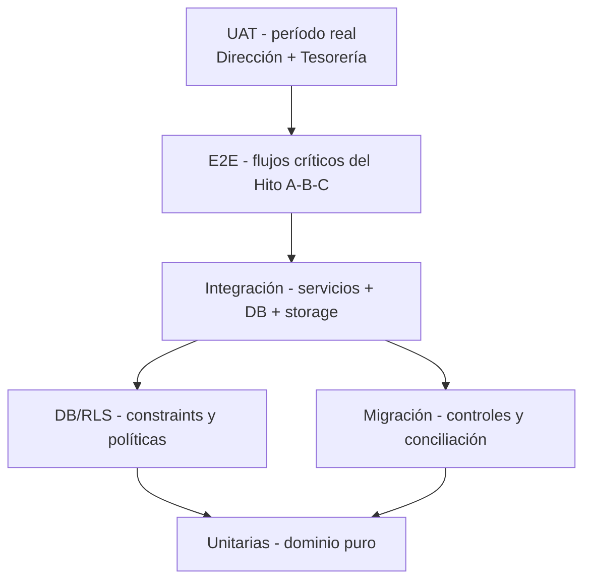

# D9 — Estrategia detallada de pruebas

> Entregable **D9** de la spec `docs/specs/sistema-financiero-diseno.md` (§5).
> Bloque **B8**. Fase: **diseño**. **No implementa tests ni configura runners.**
> Depende de **D1–D8**. Fuentes: F1 §16–§18, §21; F2 §24. Decisiones **P6**, **P11**, **P12** (spec §10).

## 0. Estado y alcance

- **Estado:** **v0 borrador**. No congelado; algunos casos dependen de P6/P11/P12 y de la política de reconocimiento (**P-REC**).
- **Incluye:** niveles de prueba; casos financieros mínimos (F1 §18); pruebas de balance, reversión, idempotencia, previsión, permisos, DB/RLS, migración, E2E y UAT; matriz RF/CU×caso; datos de prueba; criterios de salida y Definition of Done (F1 §21).
- **Excluye:** código de tests, configuración de CI, datos reales de producción.
- **Regla §9 / RNF-015:** el dominio financiero se prueba **sin navegador ni servicios externos**; toda regla financiera, permiso sensible, cálculo de previsión, reversión, idempotencia y migración debe tener prueba antes de considerarse terminada.

## 1. Pirámide de pruebas

| Nivel | Alcance | Herramienta sugerida | Velocidad |
|---|---|---|---|
| Unitarias (UT) | Dominio puro: scoring de saldos, aplicaciones, asientos, previsión, capacidad | Runner de unit tests (sin DB) | ms |
| Integración (IT) | Servicios de aplicación + persistencia + asiento + idempotencia | DB efímera/contenedor | seg |
| DB/RLS (DB) | Constraints, triggers, políticas de fila | PostgreSQL de prueba | seg |
| Migración (MG) | Pipeline + 8 controles sobre fixtures | Job reproducible | min |
| E2E (E2E) | Flujos de usuario en navegador | Runner E2E | min |
| UAT | Procesos con período real | Manual guiado | sesión |

## 2. Pruebas unitarias (dominio puro)

| ID | Caso | Invariante |
|---|---|---|
| UT-01 | Saldo por cuenta = apertura + Σ movimientos | D1 §3.4 |
| UT-02 | Transferencia no altera resultado total | D1 I-08 |
| UT-03 | `Σ applied ≤ payment.amount` y por obligación ≤ exigible | D1 I-09/I-10 |
| UT-04 | Sueldo ≠ retiro ≠ distribución (líneas separadas) | D3 M-16 |
| UT-05 | Cuenta externa excluida de disponibilidad | D1 I-17, D2 R-D8 |
| UT-06 | Aplicación de pagos distribuye correctamente el excedente como anticipo | CU-006 excepción |
| UT-07 | Dimensiones (`person`, `category`, `result_line`) se propagan al asiento | D3 §3 |
| UT-08 | Importes `numeric(18,2)`; sin punto flotante | RNF-004 |

## 3. Pruebas de balance y asientos

| ID | Caso | Resultado esperado |
|---|---|---|
| BAL-01 | Todo asiento confirmado cumple `Σ débitos = Σ créditos` | D1 I-01, D3 M-01 |
| BAL-02 | Asiento confirmado es inmutable (UPDATE/DELETE bloqueado) | D1 I-02 |
| BAL-03 | Un documento confirmado genera a lo sumo un asiento canónico | D1 I-04, D3 M-03 |
| BAL-04 | Proyección/estimación **no** genera asiento | D1 I-05, D3 M-04 |
| BAL-05 | Transferencia sin líneas de resultado | D3 M-06 |
| BAL-06 | `ENTRY_UNBALANCED` rechaza un asiento desbalanceado | D3 §8 |
| BAL-07 | Invariante de lote migrado: Σ débitos = Σ créditos | D3 EV-01, D8 §7 |

## 4. Idempotencia y concurrencia

| ID | Caso | Resultado esperado |
|---|---|---|
| IDEM-01 | Mismo `idempotency_key` en pago ⇒ devuelve el pago previo | RF-030, RNF-014, D1 I-20 |
| IDEM-02 | Mismo `idempotency_key` en transferencia ⇒ no duplica | RF-030 |
| IDEM-03 | Mismo `idempotency_key` en ingreso ⇒ no duplica movimiento | RF-030 |
| IDEM-04 | Dos requests concurrentes con la misma clave ⇒ solo uno postea | D3 M-11 |
| IDEM-05 | Clave distinta, mismo comprobante ⇒ advertencia de duplicado (no idempotencia) | CU-003 |
| IDEM-06 | Reintento no altera saldos ni asientos | D1 I-13 |

## 5. Reversión

| ID | Caso | Resultado esperado |
|---|---|---|
| REV-01 | Revertir un pago crea asiento inverso con `reverses_entry_id` | D1 I-03, D3 §6 |
| REV-02 | El asiento original permanece inmutable | D1 I-02 |
| REV-03 | Un segundo inverso del mismo original ⇒ `REVERSAL_ALREADY_EXISTS` | D1 I-03 |
| REV-04 | Revertir un pago devuelve la obligación a su saldo previo | D3 §6.5 |
| REV-05 | Anular un `BORRADOR` no genera asiento ni reversión | D3 §6.6 |
| REV-06 | Reversión exige motivo y queda auditada | D3 §6.7, RF-023 |
| REV-07 | Reversión en período cerrado ⇒ `PERIOD_CLOSED` o reapertura autorizada | D1 I-18 |

## 6. Previsión y capacidad (ver D7)

| ID | Caso | Resultado esperado |
|---|---|---|
| FC-01 | `saldo_proyectado` = conciliado + ingresos − pagos | D7 §4.1 |
| FC-02 | `min_proyectado` = mínimo del horizonte | D7 §4.2 |
| FC-03 | `capacidad = max(0, min_proyectado − reserva − protegidos)` | D7 §4.3 |
| FC-04 | Sin cierre conciliado ⇒ `STALE_RECONCILIATION` | D7 §12 |
| FC-05 | Sin reserva ⇒ `RESERVE_UNDEFINED`, capacidad bloqueada | D7 §12 |
| FC-06 | Optimista **no** autoriza inversión por sí solo | D7 F-4 |
| FC-07 | Cuenta externa no computa como caja | D7 F-6 |
| FC-08 | Transferencia esperada no se cuenta dos veces | D7 F-7 |
| FC-09 | Componente sin `source`/`confidence` es rechazado | RNF-011 |
| FC-10 | Cobertura del sueldo = (reservado+pagado)/planificado | D7 §4.4 |

## 7. Integración (servicios)

| ID | Caso | Resultado esperado |
|---|---|---|
| IT-01 | `registerPayment` crea pago + aplicación + movimiento + asiento en **una** transacción | RF-012, RNF-003, D4 §4.2 |
| IT-02 | Falla a mitad ⇒ rollback total (nada parcial) | RNF-003 |
| IT-03 | `registerDailyIncome` distribuye y postea EV-02 | CU-012 |
| IT-04 | `registerTransfer` postea dos movimientos y sin resultado | CU-008 |
| IT-05 | `registerExternalPayment` registra gasto una sola vez; sin caja propia | CU-009 |
| IT-06 | `registerDailyClosing` no genera ingreso; crea reconciliación si hay diferencia | CU-010 |
| IT-07 | `resolveDifference` con `AJUSTE` postea EV-12/12b trazable | CU-011 |
| IT-08 | `MasterDataService` propone cuenta contable/disponibilidad correctas | CU-025, F2 §13.1 |
| IT-09 | `ForecastService` no genera movimientos ni asientos | CU-015 |
| IT-10 | `AuditService` registra cada mutación auditable | RF-023 |

## 8. DB/RLS y permisos

| ID | Caso | Resultado esperado |
|---|---|---|
| DB-01 | Constraint de balance diferido rechaza asiento desbalanceado | D1 I-01 |
| DB-02 | UNIQUE(`source_document_type`,`source_document_id`) impide doble asiento | D1 I-04 |
| DB-03 | UNIQUE(`idempotency_key`) impide duplicado | D1 I-13 |
| DB-04 | CHECK origen ≠ destino en transferencia | D1 I-07 |
| DB-05 | Trigger aplicado ≤ pago | D1 I-09 |
| DB-06 | Impide postear en período `CERRADO` | D1 I-18 |
| DB-07 | Impide operar cuenta inactiva salvo `LEGACY` | D1 I-14 |
| PERM-01 | Tesorería no lee `settings_parameters` de sueldo/reserva | D6 AP-01 |
| PERM-02 | Tesorería no aprueba inversión | D6 AP-02 |
| PERM-03 | Tesorería no reabre período | D6 AP-03 |
| PERM-04 | Contador (si habilitado) no escribe | D6 AP-04 |
| PERM-05 | No autenticado no accede a ninguna tabla | D6 AP-05 |
| PERM-06 | Rol forzado en request es rechazado | D6 AP-06 |
| PERM-07 | Adjunto sin permiso sobre la entidad no accede | D6 AP-07 |
| PERM-08 | Editar/borrar asiento confirmado por API cruda ⇒ rechazado | D6 AP-08 |
| PERM-09 | Borrar/modificar `audit_events` ⇒ rechazado | D6 AP-09 |
| PERM-10 | Delegación vencida no opera | D6 AP-10 |
| PERM-11 | Admin técnico no lee importes financieros | D6 AP-11 |
| PERM-12 | Cuenta externa no usada como cuenta pagadora propia | D6 AP-12 |

## 9. Migración y conciliación (ver D8)

| ID | Caso | Resultado esperado |
|---|---|---|
| MG-01 | Extracción inmutable con hash | D8 §2 etapa 1 |
| MG-02 | Normalización de fechas/importes/nulos/IDs | D8 §3 |
| MG-03 | Control C-1: totales por período antes/después | D8 §7 |
| MG-04 | Control C-4: subcategoría→categoría válida | D8 §7 |
| MG-05 | Control C-5: transferencias balanceadas | D8 §7 |
| MG-06 | Control C-6: apertura + movimientos = cierre | D8 §7 |
| MG-07 | Control C-8: reporte de excluidos/corregidos | D8 §12 |
| MG-08 | Comisión sin ID ⇒ marca LEGACY, sin inventar ID | D8 §6 |
| MG-09 | Registro con evidencia `SOLO_SALDO` importa solo apertura | D3 EV-01 |
| MG-10 | Invariante de lote: Σ débitos = Σ créditos | D8 §7 |
| MG-11 | Rollback del corte restaura snapshot | D8 §13 |

## 10. E2E (flujos críticos)

| ID | Flujo | CU |
|---|---|---|
| E2E-01 | Alta obligación (13 preguntas) → agenda → pago total | CU-003, CU-006 |
| E2E-02 | Alta obligación → dos pagos parciales → `PAGADA` | CU-006 |
| E2E-03 | Transferencia entre cuentas propias sin efecto en resultado | CU-008 |
| E2E-04 | Pago desde cuenta externa + reintegro | CU-009 |
| E2E-05 | Ingreso diario → cierre → conciliación con diferencia | CU-012, CU-010, CU-011 |
| E2E-06 | Simulador de inversión → aprobar/postergar | CU-015, CU-016 |
| E2E-07 | Revertir un pago confirmado | CU-021 |
| E2E-08 | Cerrar período → intento de posteo → reapertura autorizada | CU-020 |
| E2E-09 | Alta guiada de cuenta externa (MARI) → verificar no-disponibilidad | CU-025 |
| E2E-10 | Alta de maestro con aprobación Dirección | CU-026, CU-027 |

## 11. UAT

- Dirección y Tesorería prueban los procesos con un **período real** antes del corte (F1 §18).
- No se habilita producción hasta que **ambos** completen sus tareas principales **sin asistencia técnica** (F1 §18).
- Test F2 §24.10: "una persona distinta ejecuta un caso completo de Tesorería solo con la app + documentación".
- Se registran incidencias y se cierran antes del Hito E.

## 12. Casos financieros mínimos (F1 §18)

| # | Caso | Cubre |
|---|---|---|
| CF-01 | Obligación pagada totalmente | CU-003, CU-006 |
| CF-02 | Obligación con dos pagos parciales | CU-006 |
| CF-03 | Anticipo antes del vencimiento | CU-006 excepción |
| CF-04 | Anulación y reemplazo | CU-021 |
| CF-05 | Devolución | RF-021 |
| CF-06 | Transferencia directa entre cuentas | CU-008 |
| CF-07 | Pago por cuenta externa y posterior reconocimiento | CU-009 |
| CF-08 | Cierre con diferencia | CU-010, CU-011 |
| CF-09 | Sueldo parcialmente cubierto | CU-014 |
| CF-10 | Inversión que supera la capacidad | CU-015 |
| CF-11 | Inversión viable en una fecha futura | CU-015, CU-016 |
| CF-12 | Mes con presupuesto pero sin movimiento real | CU-018, CU-019 |
| CF-13 | Registro histórico sin trazabilidad completa | D8, CU-021 |

## 13. Matriz de cobertura RF/CU × prueba

| Requisito | Pruebas |
|---|---|
| RF-001/002 (auth/permisos) | PERM-01..12, E2E-* |
| RF-003 (maestros) | IT-08, E2E-09/10 |
| RF-004/005 (saldos/movimientos) | UT-01, IT-03, MG-03 |
| RF-006/007 (egresos/comisiones) | IT-02, BAL-01, MG-08 |
| RF-008 (retiros) | UT-04 |
| RF-009 (transferencias) | UT-02, IT-04, E2E-03, BAL-05 |
| RF-010/013 (obligaciones/agenda) | E2E-01/02, IT-01 |
| RF-011/012 (pagos) | UT-03, IT-01/02, E2E-02 |
| RF-014 (cierres/conciliación) | IT-06/07, E2E-05 |
| RF-015/016/017 (previsión/sueldo/inversión) | FC-01..10 |
| RF-018/019/020 (presupuesto/resultado) | IT-09, CF-12 |
| RF-021 (ajustes/devoluciones) | IT-05/07, E2E-04/05 |
| RF-022 (comprobantes) | D6 §4, PERM-07 |
| RF-023 (auditoría) | IT-10, PERM-09, REV-06 |
| RF-024 (migración) | MG-01..11 |
| RF-026 (alertas) | D7 §9, FC-04/05 |
| RF-027/028 (asientos/reversión) | BAL-01..07, REV-01..07 |
| RF-029 (períodos) | DB-06, E2E-08 |
| RF-030 (idempotencia) | IDEM-01..06 |
| RF-031–035 (continuidad/maestros) | IT-08, E2E-09/10 |
| RNF-003 (transaccionalidad) | IT-01/02 |
| RNF-004 (importes) | UT-08 |
| RNF-011 (real/estimado/proyectado) | FC-09 |
| RNF-013 (balance) | BAL-01/07 |
| RNF-014 (idempotencia) | IDEM-01..06 |
| RNF-015 (dominio sin browser) | UT-* |

## 14. Datos de prueba

- **Fixtures de dominio** (unitarias): montos y fechas deterministas; nunca datos reales.
- **DB efímera** por corrida de integración; sin mezclar datos beta con productivos (spec §4).
- **Snapshot de migración sintético** que incluya: comisión sin ID, subcategoría inválida, transferencia desbalanceada, duplicado conocido, registro `SOLO_SALDO` (cubre C-4/C-5/C-7/C-8).
- **Semilla de UAT:** un período real autorizado por Dirección, en entorno aislado.

## 15. Criterios de salida y Definition of Done

### Criterios de salida (por bloque / hito)

| Gate | Criterio |
|---|---|
| Hito B (F1 §16) | Obligación pagada parcial/total; saldos correctos; transferencias sin resultado; asientos balanceados e inmutables; auditoría identifica usuario. |
| Hito C | Proyección desde saldos conciliados; cubre sueldo; capacidad y simulación. |
| Hito D | Presupuesto y resultado con las mismas líneas; sueldo/retiros/utilidades separados. |
| Hito E | Migración reconciliada; backup/restore probados; planillas en solo lectura; sin dependencia de AppSheet/Sheets. |

### Definition of Done (F1 §21)

- [ ] Requisito y regla de negocio documentados.
- [ ] Validaciones implementadas.
- [ ] Permisos verificados.
- [ ] Auditoría incluida cuando corresponde.
- [ ] Pruebas automatizadas aprobadas.
- [ ] Interfaz usable en celular y escritorio (RNF-001).
- [ ] Manejo de errores comprensible (D4 §5).
- [ ] Documentación operativa actualizada (RNF-018).
- [ ] Aceptación del usuario responsable.

## 16. Decisiones pendientes

| # | Decisión | Impacto en D9 |
|---|---|---|
| P-REC / P11 | Reconocimiento (caja vs devengamiento) | Casos EV-04/EV-05/EV-08 pueden cambiar de aserción. |
| P6 | Reglas de aprobación de inversión | CF-10/CF-11 y FC-06. |
| P12 | Límites de reversión; quién ejecuta | REV-06 y PERM-02. |
| P2 | Política de reserva | FC-03/FC-05. |
| P8 | Fecha de corte | MG-03/MG-11 dependen del alcance. |
| P14 | Umbrales/canales de alertas | Casos de alerta (FC-04/05). |

> **No-asunción:** los casos dependientes de decisiones abiertas se marcan; no se fijan umbrales ni políticas.

## 17. Próximo paso

- Cerrar la estrategia y usarla como gate de Hitos B–E (F1 §16).
- Correlacionar cada error tipado de D4 §5 con al menos una prueba.
- Realimentar D1–D8 si una prueba revela una invariante no modelada (sin cerrar decisiones PENDIENTE).
